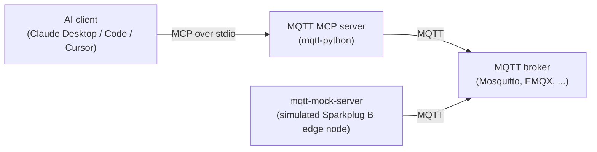

# MQTT MCP Server

[](https://github.com/IndustriAgents/MQTT-MCP/actions/workflows/ci.yml)
[](LICENSE)
[](https://www.python.org)
[](https://modelcontextprotocol.io)

A Model Context Protocol (MCP) server for MQTT and Sparkplug B. It lets AI agents and MCP‑compatible apps watch an MQTT broker (subscribe, read the messages that arrive, see which Sparkplug B edge nodes and devices are publishing, decode Sparkplug payloads) and, when you allow it, publish MQTT messages and Sparkplug B lifecycle, data and command messages. This repository contains:

- **mqtt-python** - Python MCP server using FastMCP (uv managed, console script `mqtt-mcp`)
- **mqtt-mock-server** - Simulated Sparkplug B edge node with two devices that publishes to an MQTT broker you run and acts on commands (uv managed, console script `mqtt-mock-server`)

The server is also shipped as part of the [IndustriConnect](#part-of-industriconnect) suite.



**Read-only by default.** Every tool that publishes is refused (`success: false`, nothing is sent) unless the server runs with `MQTT_WRITES_ENABLED=true`. See [Read-only by default](#read-only-by-default).

## Features

### Standard MQTT

- **Subscribe** to topic filters (`+`, `#`); the broker's acknowledgement and granted QoS are reported
- **Read received messages**: the newest `MQTT_MESSAGE_BUFFER_SIZE` (default 1000) messages that arrived on the server's subscriptions, filterable by topic and pollable by id
- **Unsubscribe** and list the subscriptions this server holds; subscriptions are restored after a reconnect
- **Publish** with QoS 0, 1, 2 and retain (needs `MQTT_WRITES_ENABLED=true`). Success is reported only when it is confirmed: QoS 0 once written to the network, QoS 1/2 once the broker acknowledges
- **Broker info**: address, TLS, client ID, connection state and last error, write gate, subscriptions
- Connects in the background and keeps retrying, both when the broker is down at startup and after a connection drops
- **TLS** for `mqtts://` URLs (system trust store or your CA file, optional client certificate)
- Username with or without password; configurable client ID

### Sparkplug B

- **Passive discovery**: edge nodes and devices seen on the server's subscriptions, with their online state, bdSeq and latest metric values (`list_sparkplug_nodes`)
- **Decoding** of Sparkplug B payloads (`decode_sparkplug_payload`, and automatically in `read_messages`)
- **Commands** (NCMD, DCMD) to any edge node or device (needs `MQTT_WRITES_ENABLED=true`)
- **This server as an edge node** (needs `MQTT_WRITES_ENABLED=true`): NBIRTH/NDEATH, DBIRTH/DDEATH, NDATA/DDATA under `SPARKPLUG_GROUP_ID`/`SPARKPLUG_EDGE_NODE_ID`, with an NDEATH Last Will, `bdSeq`, one `seq` counter per node starting at 0 with the NBIRTH, and QoS 0 for births, data and commands as the specification requires
- Payloads are encoded and decoded with the Sparkplug B protobuf schema (`sparkplug_b.proto` field numbers, `datatype` on every metric), so standard Sparkplug B host applications can read them
- Metric types: Int8/16/32/64, UInt8/16/32/64, Float, Double, Boolean, String, Text, UUID, DateTime and Bytes, with range checks; negative values use two's complement

### Mock Server

- Simulated Sparkplug B edge node (`edge-node-1`) with two devices: a sensor array whose values vary over time and a control module whose `pump_speed`, `valve_position` and `enabled` can be set with DCMD
- NDEATH Last Will with bdSeq; NBIRTH/DBIRTH on every (re)connect; periodic NDATA/DDATA; NCMD `Node Control/Rebirth`
- JSON messages on `sensors/*`, `control/*` and `system/status` that mirror the simulated values
- DDEATH/NDEATH once on shutdown (Ctrl+C or SIGTERM)

The mock is an MQTT **client**, not a broker: it needs a broker to publish to.

## Repo Layout

```
MQTT-MCP/                  — this repository (mirrored into IndustriConnect as MQTT-Project/)
├── mqtt-python/           — Python MCP server (mqtt-mcp entrypoint) and its tests (tests/)
├── mqtt-mock-server/      — Sparkplug B edge-node simulator (connects to a broker, default 127.0.0.1:1883)
├── .github/               — CI workflow, issue and pull request templates
├── CONTRIBUTING.md, SECURITY.md, CODE_OF_CONDUCT.md, LICENSE
└── README.md              — This file
```

## Install

Requires Python 3.10+, [uv](https://docs.astral.sh/uv/), and an MQTT broker (see below).

```bash
git clone https://github.com/IndustriAgents/MQTT-MCP.git
cd MQTT-MCP
(cd mqtt-python && uv sync)
(cd mqtt-mock-server && uv sync)
```

## Quick Start (Local)

### 1. Start an MQTT broker

Any MQTT 3.1.1 broker works. For local testing, Mosquitto without authentication on `127.0.0.1:1883` is enough. Pick one:

```bash
# macOS (Homebrew): runs in the foreground with -v
brew install mosquitto && mosquitto -v

# Debian/Ubuntu: the package starts the broker as a service on 127.0.0.1:1883,
# so do not run `mosquitto -v` afterwards ("Address already in use").
sudo apt install mosquitto mosquitto-clients

# Docker
docker run --rm --name mqtt-broker -p 127.0.0.1:1883:1883 eclipse-mosquitto:2 mosquitto -c /mosquitto-no-auth.conf
```

To watch the broker yourself, `mosquitto_sub -h 127.0.0.1 -t '#' -v` (in `mosquitto-clients` on Debian/Ubuntu). With the Docker route there is no `mosquitto_sub` on the host; use `docker exec mqtt-broker mosquitto_sub -h 127.0.0.1 -t '#' -v`.

### 2. Start the mock edge node

From the repository root:

```bash
cd mqtt-mock-server
uv sync
uv run mqtt-mock-server  # connects to the broker on 127.0.0.1:1883 and starts publishing
```

### 3. Run the MCP server (Python)

The mock keeps running in the foreground, so open a second terminal. In it, from the repository root:

```bash
cd mqtt-python
export MQTT_BROKER_URL=mqtt://127.0.0.1:1883
export SPARKPLUG_GROUP_ID=factory
export SPARKPLUG_EDGE_NODE_ID=mcp-server   # this server's own Sparkplug identity
# export MQTT_WRITES_ENABLED=true          # only if the agent may publish
uv sync
uv run mqtt-mcp
```

The server now waits silently for an MCP client on stdin: it speaks MCP (JSON-RPC) over stdio and logs to stderr. Normally your MCP client launches it (see [MCP Client Examples](#mcp-client-examples)), or try it interactively with `npx @modelcontextprotocol/inspector uv --directory mqtt-python run mqtt-mcp` from the repository root. `uv run mqtt-mcp --help` lists every setting.

The MCP server speaks MCP to its client over stdio and MQTT to the broker over TCP (or TLS). The mock is just another MQTT client of the same broker.

## MCP Client Examples

### Claude Desktop

**Python server (uv), read-only:**
```json
{
  "mcpServers": {
    "MQTT MCP (Python)": {
      "command": "uv",
      "args": ["--directory", "/absolute/path/to/MQTT-MCP/mqtt-python", "run", "mqtt-mcp"],
      "env": {
        "MQTT_BROKER_URL": "mqtt://127.0.0.1:1883",
        "SPARKPLUG_GROUP_ID": "factory",
        "SPARKPLUG_EDGE_NODE_ID": "mcp-server"
      }
    }
  }
}
```

To let the agent publish and send commands, add `"MQTT_WRITES_ENABLED": "true"` to `env`. Do that only for a broker and devices you are prepared to have changed.

### MCP Inspector / CLI

You can also use any MCP runner that connects to a stdio server. The tools are listed via MCP's `list_tools` and invoked with `call_tool`.

## Tools and Example Calls

Every tool returns the suite's envelope:

```json
{ "success": true, "data": { "...": "..." }, "error": null, "meta": { "...": "..." } }
```

On failure `success` is `false`, `data` is `null` and `error` says what went wrong, including invalid arguments (arguments are type-checked strictly: `true` is not accepted as a number, nor `1` as a boolean).

Write tools also report what is known about the request in `meta.outcome` and `meta.request_sent`:

| `meta.outcome` | `success` | Meaning |
|----------------|-----------|---------|
| `written` | `true` | Sent: QoS 0 written to the network, QoS 1/2 acknowledged by the broker. Whether it had any effect on a device is not known (for QoS 0 not even whether the broker got it); read the device's data to confirm |
| `not_sent` | `false` | Nothing left the server (write gate closed, invalid argument, not connected, or withdrawn before it was written) |
| `unknown` | `false` | It may have reached the broker: any failure once the message may have left (no PUBACK in time, connection dropped right after the write, a partly written packet). The error says "may have been applied; check before retrying" |
| `rejected` | `false` | Only for an explicit refusal that guarantees nothing was applied (for MQTT 5, a PUBACK with a failure reason code). MQTT 3.1.1, which this server speaks, has no such refusal, so it is never reported |

The server sends every publish and command **at most once**. Only connecting is retried; a publish whose confirmation is late or lost is never sent again by the server, and it is withdrawn from the MQTT client's queue so that it cannot go out after a reconnect. Two protocol facts remain: QoS 1 is at-least-once, so if the connection drops before the PUBACK *while the tool is still waiting*, the MQTT client resends it (flagged as a duplicate) and subscribers may get it twice; and a broker that silently drops a publish its ACL forbids (Mosquitto does) still acknowledges it, so `written` means the broker took it, not that anyone received it.

| Tool | Kind | What it does |
|------|------|--------------|
| `get_broker_info` | read | Connection state, last error, TLS, client ID, write gate, subscriptions, this server's Sparkplug state |
| `subscribe_topic` | read | Subscribe to a topic filter (success after the broker's SUBACK) |
| `unsubscribe_topic` | read | Remove one of this server's subscriptions |
| `list_subscriptions` | read | The subscriptions this server holds, with granted QoS |
| `read_messages` | read | Messages received on the subscriptions (the newest, or those after an id); Sparkplug payloads decoded |
| `list_sparkplug_nodes` | read | Edge nodes and devices seen in received Sparkplug messages |
| `decode_sparkplug_payload` | read | Decode a hex Sparkplug B payload |
| `publish_message` | write | Publish UTF-8 text with QoS and retain |
| `publish_node_command`, `publish_device_command` | write | Send NCMD/DCMD to an edge node or device |
| `publish_node_birth`, `publish_node_death` | write | This server's edge node: NBIRTH (with NDEATH will) / NDEATH |
| `publish_device_birth`, `publish_device_death` | write | DBIRTH/DDEATH for a device of this server's node |
| `publish_node_data`, `publish_device_data` | write | NDATA/DDATA for this server's node and its devices |

### Read-only by default

The write tools are listed so that an agent can see them, but each returns `success: false` with `Writes are disabled ...` and publishes nothing unless `MQTT_WRITES_ENABLED=true`. Every publish counts as a write, not only the Sparkplug commands: MQTT has no difference between data and commands, any topic can be subscribed by something that acts on it (relays, PLC gateways, other agents), a retained message stays on the broker for every future subscriber, and Sparkplug births, data and deaths published by this server change what host applications such as SCADA show and record. Subscribing and reading are not writes: they change nothing that other clients see. The exceptions are broker extensions in filters that start with `$` (other than `$SYS/`): shared subscriptions (`$share/...`, `$queue/...`) take messages away from the other members of the share group, and exclusive ones (`$exclusive/...`) lock other clients out of a topic, so they are refused while writes are disabled.

`MQTT_WRITES_ENABLED` counts only when it comes from the server's real environment (for example the `env` block of your MCP client configuration) or from a file passed explicitly with `--env-file`. The only `.env` the server loads by itself is `mqtt-python/.env` of a source checkout, found next to the package source; it never reads a `.env` from its working directory or any parent, because when an MCP client launches the server directly, the working directory is the client's project, which may not be trusted (and settings such as the broker decide where a write goes). An installed package has no automatic `.env` at all. Even `mqtt-python/.env` may set only `MQTT_*` and `SPARKPLUG_*` variables and cannot enable writes: `MQTT_WRITES_ENABLED` in it (matched in any letter case and with or without `export `, since Windows upper-cases environment names) and any other variable (`PATH`, `PYTHONPATH`, `LD_PRELOAD`, ...) are ignored with a warning on stderr.

### Standard MQTT

- Subscribe to a pattern, then read what arrives
```json
{ "tool": "subscribe_topic", "parameters": { "topic": "sensors/#", "qos": 1 } }
{ "tool": "read_messages", "parameters": { "topic_filter": "sensors/temperature", "limit": 5 } }
```

  `read_messages` returns `data` as a list of `{id, topic, qos, retain, received_at, payload, payload_encoding}` and `meta.last_id`. Pass that id as `since_id` next time to get only newer messages.

- Unsubscribe / list subscriptions / broker info
```json
{ "tool": "unsubscribe_topic", "parameters": { "topic": "sensors/#" } }
{ "tool": "list_subscriptions", "parameters": {} }
{ "tool": "get_broker_info", "parameters": {} }
```

- Publish to a topic (writes enabled)
```json
{ "tool": "publish_message", "parameters": { "topic": "sensors/temp", "payload": "22.5", "qos": 1 } }
```

### Sparkplug B

Metrics are lists of `{"name": str, "value": ..., "type": str}`; see [Data Types](#data-types).

- See which edge nodes are publishing
```json
{ "tool": "subscribe_topic", "parameters": { "topic": "spBv1.0/#" } }
{ "tool": "list_sparkplug_nodes", "parameters": {} }
```

- Send a Device Command (writes enabled)
```json
{
  "tool": "publish_device_command",
  "parameters": {
    "edge_node_id": "edge-node-1",
    "device_id": "device-2",
    "metrics": [
      {"name": "pump_speed", "value": 75, "type": "int32"}
    ]
  }
}
```

  `edge_node_id` and `group_id` default to `SPARKPLUG_EDGE_NODE_ID` and `SPARKPLUG_GROUP_ID`. Success means the DCMD went out (QoS 0, as Sparkplug requires); whether the device applied it shows in its next DDATA.

- Ask a node to republish its births (writes enabled)
```json
{
  "tool": "publish_node_command",
  "parameters": {
    "edge_node_id": "edge-node-1",
    "metrics": [{"name": "Node Control/Rebirth", "value": true, "type": "boolean"}]
  }
}
```

- Publish as an edge node yourself (writes enabled): birth first, then data
```json
{
  "tool": "publish_node_birth",
  "parameters": {
    "metrics": [
      {"name": "uptime", "value": 0, "type": "int64"},
      {"name": "status", "value": "online", "type": "string"}
    ]
  }
}
```

  The first NBIRTH makes the server reconnect with an NDEATH Last Will so that the broker announces the node's death if the server disappears. `bdSeq` and `Node Control/Rebirth` are added automatically, and the NBIRTH carries `seq` 0. DBIRTH, DDATA, NDATA and DDEATH need a born node (and DDATA/DDEATH a born device) and use the following sequence numbers. Use an `SPARKPLUG_EDGE_NODE_ID` that no real edge node uses.

- Decode a Sparkplug payload (hex)
```json
{
  "tool": "decode_sparkplug_payload",
  "parameters": { "payload_hex": "0880d0eab6b733121b0a0b74656d70657261747572651880d0eab6b733200965cdccb84112170a066f66667365741880d0eab6b733200350fbffffff0f1801" }
}
```

  The hex is a DDATA payload with `seq` 1 and two metrics: `temperature` (Float) = 23.1 and `offset` (Int32) = -5.

## Environment Variables

The server reads its configuration when it starts. Before that it merges a `.env` file into the environment: the file given with `mqtt-mcp --env-file PATH`, or else `mqtt-python/.env` of a source checkout (never the working directory or its parents; an installed package has none). Variables already set in the environment win over the file. The automatic `mqtt-python/.env` may set only `MQTT_*` and `SPARKPLUG_*` variables and not `MQTT_WRITES_ENABLED` (see [Read-only by default](#read-only-by-default)); [`mqtt-python/.env.example`](mqtt-python/.env.example) lists every setting. An invalid value stops the server with a `configuration error` message on stderr. `uv run mqtt-mcp --help` prints the list below.

### MQTT Connection

- `MQTT_BROKER_URL` - Broker URL (default: `mqtt://127.0.0.1:1883`). `mqtt://host[:port]` is plain TCP; `mqtts://host[:port]` is TLS (default port 8883). Credentials in the URL are refused; use the variables below
- `MQTT_CLIENT_ID` - Client identifier (default: `mqtt-mcp-` plus random hex, different for every process, so two servers never take each other's session). Never set it to the ID of another live client: the broker would disconnect that client (and publish its will)
- `MQTT_USERNAME` - Optional username, sent with or without a password
- `MQTT_PASSWORD` - Optional password (needs `MQTT_USERNAME`)
- `MQTT_KEEPALIVE` - Keep-alive in seconds (default: `60`)
- `MQTT_TOOL_TIMEOUT` - Seconds a tool waits for the connection and for broker acknowledgements (default: `5`)
- `MQTT_MESSAGE_BUFFER_SIZE` - Received messages kept for `read_messages` (default: `1000`)

### TLS (only with `mqtts://`)

- `MQTT_TLS_CA_FILE` - CA certificate(s) that sign the broker's certificate (default: the system trust store)
- `MQTT_TLS_CERT_FILE`, `MQTT_TLS_KEY_FILE` - Client certificate and key for brokers that require mutual TLS
- `MQTT_TLS_KEY_PASSWORD` - Password of an encrypted key file
- `MQTT_TLS_INSECURE` - `true` turns off certificate and hostname verification (default: `false`; for testing against a self-signed broker only)

Setting a TLS variable with an `mqtt://` URL is a configuration error, so TLS cannot silently be off.

### Safety

- `MQTT_WRITES_ENABLED` - `true` enables every publishing tool and `$`-prefixed subscription filters (default: `false`, read-only). Honoured only from the real environment or `--env-file`, never from an automatically found `.env`

### Sparkplug B Namespace

- `SPARKPLUG_GROUP_ID` - Group ID (default: `factory`)
- `SPARKPLUG_EDGE_NODE_ID` - Edge node ID (default: `edge-node-1`)

These are this server's own Sparkplug identity (used by the birth, data and death tools) and the default target of NCMD/DCMD. The default `edge-node-1` is also the mock's ID, which is convenient for commanding the mock; if you let the server publish births, give it an ID of its own (the examples use `mcp-server`) and pass `edge_node_id` to the command tools.

## Sparkplug B Namespace Structure

Topics follow the Sparkplug B namespace:

```
spBv1.0/<GROUP_ID>/NBIRTH/<EDGE_NODE_ID>         - Node birth
spBv1.0/<GROUP_ID>/NDEATH/<EDGE_NODE_ID>         - Node death
spBv1.0/<GROUP_ID>/NDATA/<EDGE_NODE_ID>          - Node data
spBv1.0/<GROUP_ID>/NCMD/<EDGE_NODE_ID>           - Node commands

spBv1.0/<GROUP_ID>/DBIRTH/<EDGE_NODE_ID>/<DEVICE_ID>   - Device birth
spBv1.0/<GROUP_ID>/DDEATH/<EDGE_NODE_ID>/<DEVICE_ID>   - Device death
spBv1.0/<GROUP_ID>/DDATA/<EDGE_NODE_ID>/<DEVICE_ID>    - Device data
spBv1.0/<GROUP_ID>/DCMD/<EDGE_NODE_ID>/<DEVICE_ID>     - Device commands
```

## Data Types

The metric `type` values the publish tools accept (case-insensitive):

| `type` | Sparkplug datatype | Value |
|--------|--------------------|-------|
| `int8`, `int16`, `int32` (or `int`), `int64` (or `long`) | Int8 ... Int64 | integer in range; negative values are stored as two's complement |
| `uint8`, `uint16`, `uint32`, `uint64` | UInt8 ... UInt64 | non-negative integer in range |
| `float`, `double` | Float, Double | number (Float must fit a 32-bit float) |
| `boolean` (or `bool`) | Boolean | `true` / `false` |
| `string`, `text` | String, Text | string |
| `uuid` | UUID | UUID string |
| `datetime` | DateTime | milliseconds since the Unix epoch |
| `bytes` | Bytes | hex string |

`value: null` sends a null metric. Anything else (an unknown type, a value of the wrong kind or out of range) is rejected with `success: false` and nothing is sent. Signed integers are written as their 32-bit (Int8/16/32) or 64-bit (Int64) two's complement, as the Java/C# Sparkplug libraries do; when decoding, both that form and the narrower form some libraries write are read back as the right negative number.

## Known limitations

- **MQTT 3.1.1 only**, over TCP or TLS. No MQTT 5 features and no WebSocket transport.
- **Messages are only what the server has received.** `read_messages` holds the newest `MQTT_MESSAGE_BUFFER_SIZE` messages that arrived on its subscriptions since it started (clean session: nothing is queued for it while it is offline). Older messages are dropped and counted in `meta.dropped_total`.
- **Discovery is passive.** `list_sparkplug_nodes` only knows nodes whose messages arrived on a subscription. Births are not retained, so a node born before the subscription appears with its next NDATA/DDATA; metrics that its data messages send without a datatype (allowed by Sparkplug) then show their raw stored value until the node is reborn. A read-only server cannot ask for a rebirth.
- **The server as an edge node is minimal.** It does not act on NCMD/DCMD sent to its own edge node, including `Node Control/Rebirth`, and after an unexpected disconnect (when the broker has published its NDEATH will) it does not rebirth by itself: call `publish_node_birth` again. It publishes no aliases, properties, templates, datasets or arrays.
- **Sparkplug host features are not implemented**: no `STATE` (Primary Host) messages, no sequence-gap detection or automatic rebirth requests for other nodes.
- **`publish_message` sends UTF-8 text only**, no arbitrary binary payloads.
- **Unconfirmed publishes are withdrawn using paho-mqtt internals** (so that a publish reported as `not_sent` or `unknown` is not sent later). This is why `paho-mqtt` is pinned below 3. A QoS 0 message that was not written within `MQTT_TOOL_TIMEOUT` is withdrawn if it had not started; if it had, the outcome is `unknown`.
- **The first `publish_node_birth` reconnects** (to register the NDEATH will): messages that arrive during the reconnect are missed, retained messages on the subscriptions are delivered again (so `read_messages` shows them twice), and a subscribe running at that moment fails.
- **Discovery goes stale across this server's own reconnects.** Deaths published while it was disconnected are missed, so after a reconnect every discovered node and device shows `online: null` until it is heard from again.
- **bdSeq starts at 0 in every server process**, as the specification asks. If a previous server process with the same edge node ID died without its will being delivered yet, a host may match that late will to the new node.

## Testing With The Mock Server

### Basic MQTT Test

1. Subscribe to all sensors:
```json
{ "tool": "subscribe_topic", "parameters": { "topic": "sensors/#" } }
```

2. The mock publishes JSON every 2 seconds to:
   - `sensors/temperature` → `{"value": 23.18, "unit": "°C"}` (follows device-1's temperature)
   - `sensors/pressure`, `sensors/humidity`
   - `control/pump`, `control/valve` (follow device-2's metrics) and `system/status`

3. Read them:
```json
{ "tool": "read_messages", "parameters": { "topic_filter": "sensors/#", "limit": 6 } }
```

### Sparkplug B Test

1. Check the connection:
```json
{ "tool": "get_broker_info", "parameters": {} }
```

2. Subscribe to the mock's Sparkplug traffic and list what is seen:
```json
{ "tool": "subscribe_topic", "parameters": { "topic": "spBv1.0/factory/#" } }
{ "tool": "list_sparkplug_nodes", "parameters": {} }
```

   Within a few seconds `edge-node-1` appears with `device-1` (temperature, pressure, flow_rate) and `device-2` (pump_speed, valve_position, enabled) and their current values. `read_messages` shows the decoded NDATA/DDATA messages.

3. Send a command to device-2 (needs `MQTT_WRITES_ENABLED=true`):
```json
{
  "tool": "publish_device_command",
  "parameters": {
    "edge_node_id": "edge-node-1",
    "device_id": "device-2",
    "metrics": [
      {"name": "pump_speed", "value": 80, "type": "int32"},
      {"name": "enabled", "value": true, "type": "boolean"}
    ]
  }
}
```

   The mock applies it, logs `Command: set device-2/pump_speed=80`, and publishes a DDATA with the new values, which `list_sparkplug_nodes` then shows. Device-1's sensor metrics are read-only; the mock rejects writes to them and out-of-range values (pump_speed and valve_position take 0-100).

## Development

### Python Version

- Requires Python 3.10+ and uv
- From `mqtt-python`: `uv sync`, then `uv run mqtt-mcp`
- Uses FastMCP for async tool handlers

### Tests

From `mqtt-python`: `uv run pytest`. The unit tests need nothing. The integration tests start the mock and drive the real server over stdio against a broker: they use the broker in `MQTT_TEST_BROKER_URL` (for example `MQTT_TEST_BROKER_URL=mqtt://127.0.0.1:1883 uv run pytest`) or start their own if `mosquitto` is on `PATH`, and are skipped otherwise. See [CONTRIBUTING.md](CONTRIBUTING.md#checks-ci-runs).

### Mock Server

- From `mqtt-mock-server`: `uv sync`, then `uv run mqtt-mock-server`
- Simulates a Sparkplug B edge node; needs a running broker

### CI

[CI](.github/workflows/ci.yml) syncs both projects from their committed `uv.lock` on Python 3.10 and 3.14, runs `ruff check` and `ruff format --check`, byte-compiles, imports the console-script targets, runs `mqtt-mcp --help` and an MCP `initialize` + `tools/list` handshake without a broker, then starts Mosquitto in Docker and runs the full pytest suite (unit and integration) and a short run of the mock. A `lowest-direct` job runs the suite again with the lowest declared versions of the direct dependencies, so the floors in `pyproject.toml` stay true.

## Troubleshooting

### Not connected to the broker

**Issue:** `get_broker_info` reports `"connected": false`, and tools that need the broker return `Not connected to the MQTT broker ...`
- `last_error` in `get_broker_info` says why (connection refused, certificate verification failed, not authorized, ...)
- Ensure an MQTT broker is running and reachable at `MQTT_BROKER_URL` (the mock is not a broker)
- The server keeps retrying (every 1 to 10 seconds), so it connects once the broker is up; no restart is needed
- For `mqtts://`, check the CA (`MQTT_TLS_CA_FILE`) and that the certificate's name matches the host in the URL

### Writes are disabled

**Issue:** a publish or command tool returns `Writes are disabled ...`
- The server is read-only unless it is started with `MQTT_WRITES_ENABLED=true` in its real environment or an `--env-file` (see [Read-only by default](#read-only-by-default))
- If you put `MQTT_WRITES_ENABLED=true` in `mqtt-python/.env`, it is ignored on purpose; stderr says `Ignoring MQTT_WRITES_ENABLED ...`. A `.env` anywhere else (for example in your project's directory) is not read at all. Set it in the MCP client's `env` block or pass the file with `--env-file`

### No Devices Appearing

**Issue:** `list_sparkplug_nodes` returns no nodes
- Subscribe to `spBv1.0/#` (or `spBv1.0/<group>/#`) first: discovery only sees messages that arrive on the server's subscriptions
- Check that the edge node publishes to the broker, e.g. `mosquitto_sub -h 127.0.0.1 -t 'spBv1.0/#' -v`

### Sequence Number Errors

**Issue:** a Sparkplug B host application reports sequence gaps or asks for a rebirth for this server's node
- The server uses one `seq` counter for its node and devices, starting at 0 with each NBIRTH; only messages that were actually sent advance it
- After an unexpected disconnect the node is dead until `publish_node_birth` is called again; the server does not answer rebirth requests itself

### Type Conversion Errors

**Issue:** `metric 'x': ... out of range for int8` or `... must be an integer`
- Use values that match the declared `type` and its range (see [Data Types](#data-types))

## Performance Notes

- MQTT QoS 0 is fastest but provides no delivery guarantee; the broker does not acknowledge it, so success means "written to the network"
- QoS 1 and 2 are acknowledged by the broker at the cost of latency (QoS 1 is at-least-once: duplicates are possible after a reconnect)
- Sparkplug B NBIRTH, DBIRTH, NDATA, DDATA, DDEATH, NCMD and DCMD are published with QoS 0, as the specification requires; NDEATH (the will and the explicit one) uses QoS 1
- Sequence numbers wrap after 255

## Security

The server is read-only unless `MQTT_WRITES_ENABLED=true` is set in its real environment or an explicit `--env-file` (the automatic `mqtt-python/.env` cannot enable writes, and no `.env` is read from the working directory). Every tool call has an overall deadline. It sends each publish at most once and reports `meta.outcome: "unknown"` when it cannot tell whether a message got through. It supports TLS (`mqtts://`) with certificate verification, mutual TLS, and username/password authentication. For production use:
- Use a production MQTT broker with authentication and TLS
- Give the server's MQTT account ACLs that allow exactly the topics you intend; the broker is the only place to limit what it can read and, with writes enabled, publish
- Enable writes only where an agent is meant to change things
- Use environment variables for secrets (avoid hardcoding credentials)

The mock edge node is designed for local development only. It has no TLS and no authentication, and it connects to `127.0.0.1` by default; keep it and its broker on localhost.

See [SECURITY.md](SECURITY.md) for the full security posture and how to report a vulnerability.

## Part of IndustriConnect

This server is one of the protocol servers in [IndustriConnect](https://github.com/IndustriAgents/IndustriConnect), a suite of MCP servers for industrial protocols (Modbus, MQTT/Sparkplug B, OPC UA, BACnet, DNP3, EtherCAT, EtherNet/IP, PROFIBUS, PROFINET and S7comm), each with a mock device. In the suite it appears as the `MQTT-Project/` folder, a git submodule that tracks this repository's `main` branch. This repository is where the MQTT server is developed, so open issues and pull requests here.

## Contributing

Contributions are welcome. See [CONTRIBUTING.md](CONTRIBUTING.md) for local setup, the checks CI runs, and pull request conventions. By taking part you agree to the [Code of Conduct](CODE_OF_CONDUCT.md).

## License

MIT, see [LICENSE](LICENSE).

## Related Resources

- [Sparkplug B Specification](https://sparkplug.eclipse.org/specification/)
- [MQTT 3.1.1 Specification](https://docs.oasis-open.org/mqtt/mqtt/v3.1.1/mqtt-v3.1.1.html)
- [MCP Documentation](https://modelcontextprotocol.io/)
- [paho-mqtt Python Library](https://github.com/eclipse-paho/paho.mqtt.python)
- [Eclipse Tahu Sparkplug Libraries](https://github.com/eclipse-tahu/tahu)
