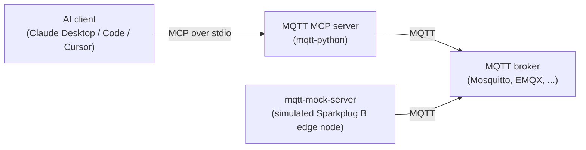

# MQTT MCP Server

[](https://github.com/IndustriAgents/MQTT-MCP/actions/workflows/ci.yml)
[](LICENSE)
[](https://www.python.org)
[](https://modelcontextprotocol.io)

A Model Context Protocol (MCP) server for MQTT and Sparkplug B. It lets AI agents and MCP‑compatible apps publish MQTT messages, manage subscriptions on a broker, and send Sparkplug B lifecycle, data and command messages. This repository contains:

- **mqtt-python** - Python MCP server using FastMCP (uv managed, console script `mqtt-mcp`)
- **mqtt-mock-server** - Simulated Sparkplug B edge node with two devices that publishes to an MQTT broker you run (uv managed, console script `mqtt-mock-server`)

The server is also shipped as part of the [IndustriConnect](#part-of-industriconnect) suite.



## Features

### Standard MQTT

- **Publish** with QoS (0, 1, 2) and retain flags
- **Subscribe** to topic patterns with wildcard support (+, #). The subscription is registered with the broker, but received messages are not stored or returned yet (see [Known limitations](#known-limitations))
- **Unsubscribe** and list the subscriptions this server has made
- **Broker info** reporting (address and connection state)
- Automatic reconnection if an established connection drops (the broker must be reachable when the server starts)
- Optional username/password authentication (no TLS yet)

### Sparkplug B

- **Birth Certificates** (NBIRTH, DBIRTH) with metrics
- **Death Certificates** (NDEATH, DDEATH)
- **Data Messages** (NDATA, DDATA) with metric updates
- **Commands** (NCMD, DCMD) for device control
- Topics on the `spBv1.0` namespace
- **Sequence numbers** per node and per device (not spec-conformant, see [Known limitations](#known-limitations))
- **Timestamp handling** with millisecond precision
- Payloads are protobuf-encoded by a small built-in encoder that does not yet match `sparkplug_b.proto` field for field (see [Known limitations](#known-limitations))

### Mock Server

- Simulated Sparkplug B edge node (`edge-node-1`) with two devices
- Periodic NDATA/DDATA updates (device-1's sensor metrics vary over time)
- Birth/death certificate publishing
- JSON messages on standard MQTT topics for testing
- Environment-configurable behavior

The mock is an MQTT **client**, not a broker: it needs a broker to publish to.

## Repo Layout

```
MQTT-MCP/                  — this repository (mirrored into IndustriConnect as MQTT-Project/)
├── mqtt-python/           — Python MCP server (mqtt-mcp entrypoint)
├── mqtt-mock-server/      — Sparkplug B edge-node simulator (connects to a broker, default 127.0.0.1:1883)
├── .github/               — CI workflow, issue and pull request templates
├── CONTRIBUTING.md, SECURITY.md, CODE_OF_CONDUCT.md, LICENSE
└── README.md              — This file
```

## Install

Requires Python 3.10+, [uv](https://docs.astral.sh/uv/), and an MQTT broker (see below).

```bash
git clone https://github.com/IndustriAgents/MQTT-MCP.git
cd MQTT-MCP
(cd mqtt-python && uv sync)
(cd mqtt-mock-server && uv sync)
```

## Quick Start (Local)

### 1. Start an MQTT broker

Any MQTT 3.1.1 broker works. For local testing, Mosquitto without authentication on `127.0.0.1:1883` is enough:

```bash
mosquitto -v   # brew install mosquitto / apt install mosquitto
# or: docker run --rm -p 127.0.0.1:1883:1883 eclipse-mosquitto:2 mosquitto -c /mosquitto-no-auth.conf
```

### 2. Start the mock edge node

From the repository root:

```bash
cd mqtt-mock-server
uv sync
uv run mqtt-mock-server  # connects to the broker on 127.0.0.1:1883 and starts publishing
```

### 3. Run the MCP server (Python)

The mock keeps running in the foreground, so open a second terminal. In it, from the repository root:

**Python (uv):**
```bash
cd mqtt-python
export MQTT_BROKER_URL=mqtt://127.0.0.1:1883
export SPARKPLUG_GROUP_ID=factory
export SPARKPLUG_EDGE_NODE_ID=edge-node-1
uv sync
uv run mqtt-mcp
```

The MCP server speaks MCP to its client over stdio and MQTT to the broker over TCP. The mock is just another MQTT client of the same broker.

## MCP Client Examples

### Claude Desktop

**Python server (uv):**
```json
{
  "mcpServers": {
    "MQTT MCP (Python)": {
      "command": "uv",
      "args": ["--directory", "/absolute/path/to/MQTT-MCP/mqtt-python", "run", "mqtt-mcp"],
      "env": { 
        "MQTT_BROKER_URL": "mqtt://127.0.0.1:1883",
        "SPARKPLUG_GROUP_ID": "factory",
        "SPARKPLUG_EDGE_NODE_ID": "edge-node-1"
      }
    }
  }
}
```

### MCP Inspector / CLI

You can also use any MCP runner that connects to a stdio server. The tools are listed via MCP's `list_tools` and invoked with `call_tool`.

## Tools and Example Calls

Each tool returns a short plain-text result, or a message starting with `Error` when something fails. (The shared `{ success, data, error, meta }` envelope that IndustriConnect aims for across its servers is not implemented in this server yet.)

### Standard MQTT

- Publish to a topic
```json
{ "tool": "publish_message", "parameters": { "topic": "sensors/temp", "payload": "22.5", "qos": 1 } }
```

- Subscribe to a pattern
```json
{ "tool": "subscribe_topic", "parameters": { "topic": "sensors/#", "qos": 1 } }
```

- Unsubscribe
```json
{ "tool": "unsubscribe_topic", "parameters": { "topic": "sensors/#" } }
```

- List subscriptions
```json
{ "tool": "list_subscriptions", "parameters": {} }
```

- Get broker info
```json
{ "tool": "get_broker_info", "parameters": {} }
```

### Sparkplug B

- Publish Node Birth
```json
{ 
  "tool": "publish_node_birth", 
  "parameters": { 
    "metrics": [
      {"name": "uptime", "value": 0, "type": "int32"},
      {"name": "status", "value": "online", "type": "string"}
    ]
  } 
}
```

- Publish Device Birth
```json
{ 
  "tool": "publish_device_birth", 
  "parameters": { 
    "device_id": "device-1",
    "metrics": [
      {"name": "temperature", "value": 22.5, "type": "float"},
      {"name": "enabled", "value": true, "type": "bool"}
    ]
  } 
}
```

- Publish Device Data
```json
{ 
  "tool": "publish_device_data", 
  "parameters": { 
    "device_id": "device-1",
    "metrics": [
      {"name": "temperature", "value": 23.1, "type": "float"}
    ]
  } 
}
```

- Send Device Command
```json
{ 
  "tool": "publish_device_command", 
  "parameters": { 
    "device_id": "device-1",
    "metrics": [
      {"name": "pump_speed", "value": 75, "type": "int32"}
    ]
  } 
}
```

- List discovered nodes
```json
{ "tool": "list_sparkplug_nodes", "parameters": {} }
```

- Decode Sparkplug payload (hex)
```json
{ 
  "tool": "decode_sparkplug_payload", 
  "parameters": { "payload_hex": "08898cb8ab903412190a0b74656d706572617475726510898cb8ab90344dcdccb8411801" } 
}
```

  The hex is a DDATA payload as this server's built-in encoder produces it: one float metric, `temperature` = 23.1, with `seq` 1. Note: this tool currently returns an error (see [Known limitations](#known-limitations)).

## Environment Variables

### MQTT Connection

- `MQTT_BROKER_URL` - Broker URL (default: `mqtt://127.0.0.1:1883`)
  - Format: `mqtt://host:port`. An `mqtts://` prefix is accepted, but TLS is not set up: the connection is plain TCP
- `MQTT_CLIENT_ID` - Client identifier (default: `mqtt-mcp-python`). Currently ignored: the broker assigns the ID (see [Known limitations](#known-limitations))
- `MQTT_USERNAME` - Optional username (used only together with `MQTT_PASSWORD`)
- `MQTT_PASSWORD` - Optional password
- `MQTT_KEEPALIVE` - Keep-alive in seconds (default: `60`)

### Sparkplug B Namespace

- `SPARKPLUG_GROUP_ID` - Group ID for Sparkplug topics (default: `factory`)
- `SPARKPLUG_EDGE_NODE_ID` - Edge node ID (default: `edge-node-1`)

The server publishes every Sparkplug message as this group and edge node, including NCMD/DCMD commands, which are addressed to that edge node. To command the mock's devices, keep the mock's IDs (the defaults match).

## Sparkplug B Namespace Structure

Topics follow the Sparkplug B namespace:

```
spBv1.0/<GROUP_ID>/NBIRTH/<EDGE_NODE_ID>         - Node birth
spBv1.0/<GROUP_ID>/NDEATH/<EDGE_NODE_ID>         - Node death
spBv1.0/<GROUP_ID>/NDATA/<EDGE_NODE_ID>          - Node data
spBv1.0/<GROUP_ID>/NCMD/<EDGE_NODE_ID>           - Node commands

spBv1.0/<GROUP_ID>/DBIRTH/<EDGE_NODE_ID>/<DEVICE_ID>   - Device birth
spBv1.0/<GROUP_ID>/DDEATH/<EDGE_NODE_ID>/<DEVICE_ID>   - Device death
spBv1.0/<GROUP_ID>/DDATA/<EDGE_NODE_ID>/<DEVICE_ID>    - Device data
spBv1.0/<GROUP_ID>/DCMD/<EDGE_NODE_ID>/<DEVICE_ID>     - Device commands
```

## Data Types

The metric `type` values the built-in encoder understands:

- **int32** (or **int**) - integer (non-negative only, see below)
- **float** - 32-bit IEEE 754 float
- **bool** - True/false value
- **string** - UTF-8 string

Any other `type`, including `boolean`, is sent as a string. Sparkplug B defines further data types (Int64, Double, DateTime, ...) that this server does not encode.

## Known limitations

These are open issues in the current code, listed here so this README does not promise more than the server does:

- **Received messages are not surfaced.** `subscribe_topic` registers the subscription with the broker, but incoming messages are discarded and no tool returns them.
- **`list_sparkplug_nodes` does not discover nodes.** It lists only the births this server has published itself, not edge nodes seen on the broker.
- **`decode_sparkplug_payload` fails** with `name 'sparkplug_b_pb2' is not defined`: the protobuf module it relies on is neither imported nor shipped.
- **Payloads are not readable by standard Sparkplug B decoders.** The built-in encoder uses different metric field numbers from `sparkplug_b.proto` (for example, the metric timestamp lands in `alias`) and sends no `datatype`. The mock uses the same encoder.
- **Negative integer metrics hang the server**: the varint encoder never terminates for negative numbers.
- **No NDEATH Last Will**: the server does not register an NDEATH as its MQTT will message.
- **Sparkplug sequence numbers do not follow the specification.** Sparkplug B gives each edge node one `seq` counter, shared by the NBIRTH, NDATA, DBIRTH, DDATA and DDEATH messages of that node and its devices, and requires the NBIRTH to carry `seq` 0 together with a `bdSeq` metric. The server instead keeps a separate counter for the node and for each device, so its first message on each counter (normally the NBIRTH or a DBIRTH) goes out with `seq` 1, and it sends no `bdSeq`. NCMD/DCMD also advance these counters. A spec-conformant host application will see sequence gaps. The mock keeps a single counter for the node and its devices, but it also starts at 1 and sends no `bdSeq`.
- **Subscriptions are not restored after a reconnect.** The server connects with a clean session and does not resubscribe when it reconnects, so after a broker restart or network drop the broker has forgotten the subscriptions while `list_subscriptions` still lists them. Call `subscribe_topic` again once the server is back online.
- **`MQTT_CLIENT_ID` is not used.** The variable is read but never passed to the MQTT client, which connects with an empty client ID, so the broker assigns one (Mosquitto logs it as `auto-...`).
- **No TLS and no read-only mode**; see [Security](#security).
- **The broker must be reachable when the server starts**; see [Troubleshooting](#not-connected-to-the-broker).

## Testing With The Mock Server

### Basic MQTT Test

1. Subscribe to all sensors:
```json
{ "tool": "subscribe_topic", "parameters": { "topic": "sensors/#" } }
```

2. The mock publishes JSON every 2 seconds to:
   - `sensors/temperature` → `{"value": 22.5, "unit": "°C"}`
   - `sensors/pressure` → `{"value": 101.3, "unit": "kPa"}`
   - `sensors/humidity` → `{"value": 55, "unit": "%"}`
   - `control/pump`, `control/valve` and `system/status`

3. The server registers the subscription but does not return received messages yet. To see the traffic, watch the broker directly, for example `mosquitto_sub -h 127.0.0.1 -t 'sensors/#' -v`.

### Sparkplug B Test

1. Check the connection:
```json
{ "tool": "get_broker_info", "parameters": {} }
```

2. The mock publishes NBIRTH and DBIRTH at startup, then NDATA and DDATA for `device-1` and `device-2`. Device-1's temperature, pressure and flow rate vary over time. `mosquitto_sub -h 127.0.0.1 -t 'spBv1.0/#' -v` shows the messages (payloads are binary). `list_sparkplug_nodes` does not list the mock's edge node; it lists only births this server has published.

3. Subscribe to device data:
```json
{ "tool": "subscribe_topic", "parameters": { "topic": "spBv1.0/factory/DDATA/edge-node-1/+" } }
```

4. Mock server publishes device metrics every 2 seconds

5. Send a command to device:
```json
{ 
  "tool": "publish_device_command", 
  "parameters": { 
    "device_id": "device-2",
    "metrics": [
      {"name": "pump_speed", "value": 80, "type": "int32"}
    ]
  } 
}
```

   The mock does not subscribe to NCMD/DCMD, so the command reaches the broker but nothing acts on it.

## Example Commands

### Getting Started

**Check broker connection status:**
```json
{ "tool": "get_broker_info", "parameters": {} }
```

**List active subscriptions:**
```json
{ "tool": "list_subscriptions", "parameters": {} }
```

### Subscribing to Sensor Data

These register subscriptions on the broker; received messages are not returned yet (see [Known limitations](#known-limitations)).

**Subscribe to the temperature topic:**
```json
{ "tool": "subscribe_topic", "parameters": { "topic": "sensors/temperature", "qos": 1 } }
```

**Subscribe to all sensors (wildcard):**
```json
{ "tool": "subscribe_topic", "parameters": { "topic": "sensors/#", "qos": 1 } }
```

**Subscribe to all Sparkplug device data:**
```json
{ "tool": "subscribe_topic", "parameters": { "topic": "spBv1.0/factory/DDATA/edge-node-1/+", "qos": 1 } }
```

**List the Sparkplug births this server has published:**
```json
{ "tool": "list_sparkplug_nodes", "parameters": {} }
```

### Publishing Data

**Publish a temperature reading:**
```json
{ "tool": "publish_message", "parameters": { "topic": "sensors/temperature", "payload": "23.5", "qos": 1, "retain": false } }
```

**Publish JSON sensor data:**
```json
{ "tool": "publish_message", "parameters": { "topic": "sensors/custom", "payload": "{\"temp\": 24.2, \"humidity\": 60}", "qos": 1 } }
```

**Publish Sparkplug device data update:**
```json
{ 
  "tool": "publish_device_data", 
  "parameters": { 
    "device_id": "device-1",
    "metrics": [
      {"name": "temperature", "value": 24.3, "type": "float"},
      {"name": "pressure", "value": 102.1, "type": "float"}
    ]
  } 
}
```

### Controlling Devices

**Set pump speed to 75%:**
```json
{ 
  "tool": "publish_device_command", 
  "parameters": { 
    "device_id": "device-2",
    "metrics": [
      {"name": "pump_speed", "value": 75, "type": "int32"}
    ]
  } 
}
```

**Control valve position:**
```json
{ 
  "tool": "publish_device_command", 
  "parameters": { 
    "device_id": "device-2",
    "metrics": [
      {"name": "valve_position", "value": 65, "type": "int32"}
    ]
  } 
}
```

**Enable/disable device:**
```json
{ 
  "tool": "publish_device_command", 
  "parameters": { 
    "device_id": "device-2",
    "metrics": [
      {"name": "enabled", "value": true, "type": "bool"}
    ]
  } 
}
```

### Managing Subscriptions

**Unsubscribe from a topic:**
```json
{ "tool": "unsubscribe_topic", "parameters": { "topic": "sensors/temperature" } }
```

**Unsubscribe from all sensors:**
```json
{ "tool": "unsubscribe_topic", "parameters": { "topic": "sensors/#" } }
```

### Complete Workflow Examples

**Subscribe to all sensors:**
```json
// Step 1: Subscribe to all sensor topics
{ "tool": "subscribe_topic", "parameters": { "topic": "sensors/#", "qos": 1 } }

// Step 2: Subscribe to Sparkplug device data
{ "tool": "subscribe_topic", "parameters": { "topic": "spBv1.0/factory/DDATA/edge-node-1/+", "qos": 1 } }

// Step 3: Check what you're subscribed to
{ "tool": "list_subscriptions", "parameters": {} }
```

**Create and manage a device:**
```json
// Step 1: Publish device birth certificate
{ 
  "tool": "publish_device_birth", 
  "parameters": { 
    "device_id": "my-sensor",
    "metrics": [
      {"name": "temperature", "value": 22.5, "type": "float"},
      {"name": "humidity", "value": 55.0, "type": "float"}
    ]
  } 
}

// Step 2: Update device data periodically
{ 
  "tool": "publish_device_data", 
  "parameters": { 
    "device_id": "my-sensor",
    "metrics": [
      {"name": "temperature", "value": 23.1, "type": "float"}
    ]
  } 
}

// Step 3: Publish device death when shutting down
{ 
  "tool": "publish_device_death", 
  "parameters": { 
    "device_id": "my-sensor"
  } 
}
```

**Node lifecycle management:**
```json
// Step 1: Publish node birth
{ 
  "tool": "publish_node_birth", 
  "parameters": { 
    "metrics": [
      {"name": "uptime", "value": 0, "type": "int32"},
      {"name": "status", "value": "online", "type": "string"}
    ]
  } 
}

// Step 2: Update node data (e.g., every minute)
{ 
  "tool": "publish_node_data", 
  "parameters": { 
    "metrics": [
      {"name": "uptime", "value": 3600, "type": "int32"},
      {"name": "status", "value": "online", "type": "string"}
    ]
  } 
}

// Step 3: Publish node death on shutdown
{ "tool": "publish_node_death", "parameters": {} }
```

## Development

### Python Version

- Requires Python 3.10+ and uv
- From `mqtt-python`: `uv sync`, then `uv run mqtt-mcp`
- Uses FastMCP for async tool handlers

### Mock Server

- From `mqtt-mock-server`: `uv sync`, then `uv run mqtt-mock-server`
- Simulates a Sparkplug B edge node; needs a running broker

### CI

[CI](.github/workflows/ci.yml) syncs both projects from their committed `uv.lock`, byte-compiles them, imports the console-script targets, and runs an MCP `initialize` + `tools/list` handshake against the server. No broker is needed for any of it. See [CONTRIBUTING.md](CONTRIBUTING.md#checks-ci-runs) to run the same checks locally.

## Troubleshooting

### Not connected to the broker

**Issue:** `get_broker_info` reports `Connected: False`, and publish/subscribe tools return `Not connected to MQTT broker`
- **Solution:** Ensure an MQTT broker is running and reachable at `MQTT_BROKER_URL` (the mock is not a broker)
- Check broker address and port match (default: `127.0.0.1:1883`)
- The server only reconnects after a connection it has already made drops. If the broker was not up when the server started, restart the server (or your MCP client) once the broker is running

### No Devices Appearing

**Issue:** `list_sparkplug_nodes` returns empty
- This is expected until this server publishes a birth itself: the tool lists the certificates published with `publish_node_birth` / `publish_device_birth`, not edge nodes discovered on the broker
- To check that the mock is publishing, watch the broker: `mosquitto_sub -h 127.0.0.1 -t 'spBv1.0/#' -v`

### Sequence Number Errors

**Issue:** A Sparkplug B host application reports sequence gaps or asks for a rebirth
- The server numbers the node and each device with separate counters that start at 1, and sends no `bdSeq`, which a spec-conformant host does not expect (see [Known limitations](#known-limitations))
- Within one counter, every message the server publishes for that node or device (birth, data, death and command) takes the next number, wrapping after 255

### Type Conversion Errors

**Issue:** `Error publishing ...: could not convert string to float` (or `invalid literal for int()`)
- **Solution:** Ensure metric values match their declared types
- Use integers for "int32", floats for "float", true/false for "bool", strings for "string"

## Performance Notes

- MQTT QoS 0 is fastest but provides no delivery guarantee
- QoS 1 and 2 provide delivery guarantees at the cost of latency
- Sparkplug B birth certificates (NBIRTH/DBIRTH) use QoS 1 for reliability
- Data updates (NDATA/DDATA) use QoS 0 for low latency
- Sequence numbers wrap at 256 (0-255)

## Security

The mock edge node is designed for local development only. It has no TLS and no authentication, and it connects to `127.0.0.1` by default; keep it and its broker on localhost.

The MCP server supports username/password authentication but **not TLS** yet, and it exposes every tool, including the command tools, with no read-only mode. For production use:
- Use a production MQTT broker with authentication
- Until TLS is supported, keep the broker on the same host or a segmented network
- Implement proper ACLs on topics; they are the only way to limit what the agent can publish
- Use environment variables for secrets (avoid hardcoding credentials)

See [SECURITY.md](SECURITY.md) for the full security posture and how to report a vulnerability.

## Part of IndustriConnect

This server is one of the protocol servers in [IndustriConnect](https://github.com/IndustriAgents/IndustriConnect), a suite of MCP servers for industrial protocols (Modbus, MQTT/Sparkplug B, OPC UA, BACnet, DNP3, EtherCAT, EtherNet/IP, PROFIBUS, PROFINET and S7comm), each with a mock device. In the suite it appears as the `MQTT-Project/` folder, a git submodule that tracks this repository's `main` branch. This repository is where the MQTT server is developed, so open issues and pull requests here.

## Contributing

Contributions are welcome. See [CONTRIBUTING.md](CONTRIBUTING.md) for local setup, the checks CI runs, and pull request conventions. By taking part you agree to the [Code of Conduct](CODE_OF_CONDUCT.md).

## License

MIT, see [LICENSE](LICENSE).

## Related Resources

- [Sparkplug B Specification](https://sparkplug.eclipse.org/specification/)
- [MQTT 3.1.1 Specification](https://docs.oasis-open.org/mqtt/mqtt/v3.1.1/mqtt-v3.1.1.html)
- [MCP Documentation](https://modelcontextprotocol.io/)
- [paho-mqtt Python Library](https://github.com/eclipse-paho/paho.mqtt.python)
- [Eclipse Tahu Sparkplug Libraries](https://github.com/eclipse-tahu/tahu)
